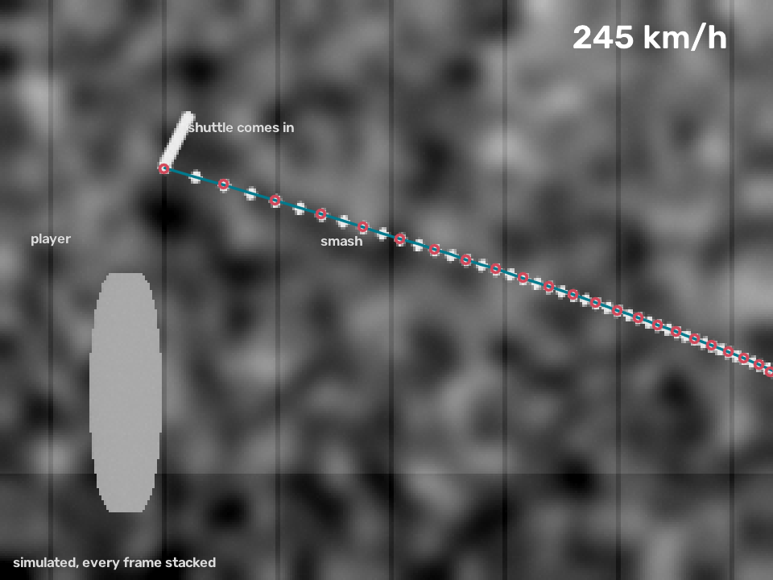
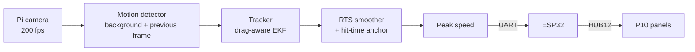

# Shuttle Speed Cam

**How fast was that smash?** A Raspberry Pi Zero 2 W with a 200 fps camera tracks
the shuttle, a Kalman filter that knows how shuttles slow down works out its speed
off the racket, and a P10 LED board shows the number to the whole hall.

[](https://github.com/RyanEngineering2/shuttle-speed-cam/actions/workflows/ci.yml)
[](LICENSE)



## Why

I built this for the youth badminton community I play with in Jakarta, as a
small way to give something back using my own field. Everyone wants to know how
hard they can smash. Friends from the group helped test it and chipped in for
parts.

It took two tries. The first version ran on an **ESP32-CAM with an OV2640**. It
worked, but couldn't go past about 30 fps, and a shuttle slows down so fast that
30 fps misses most of the smash. The current version moved the vision work to a
**Raspberry Pi Zero 2 W** with a better, high-frame-rate camera, and kept an ESP32
to drive the **P10 LED panels**.

## How it works



A shuttle is not a ball. Its feathers give it a terminal velocity of only about
24 km/h, so a 250 km/h smash starts out decelerating at **over 100 g**. In the
33 ms between two frames at 30 fps it slows to 166 km/h. So:

1. **Detect** fast-moving blobs. A pixel counts if it differs from a running
   background *and* from the previous frame. Mains flicker is cancelled, and
   player-sized blobs are ignored.
2. **Track** them with an **extended Kalman filter whose motion model includes
   quadratic air drag and gravity**, in metres. A homography calibration maps
   pixels onto the plane of flight.
3. **Smooth** each finished track backwards with a **Rauch–Tung–Striebel
   smoother**, so the estimate at the start of the flight uses every later point.
4. **Anchor the hit.** The hit falls between frames, so the first point is often
   the shuttle still on the racket. It's used as a position only, and the
   trajectory is run back to find when the shuttle actually left.
5. Report the peak speed, and send `SPEED 245 278` to the display.

The full write-up, with the math: **[docs/how-it-works.md](docs/how-it-works.md)**.

### Match footage from any angle: 3D mode

Most badminton video is filmed from behind a baseline, where the shuttle flies
toward or away from the camera. `shuttlecam analyze3d` calibrates the camera from
the **court lines and net posts**, fits each shot's **full 3D flight** with the
same drag physics, times the hit from the **incoming shuttle**, and reports the
launch speed with an honest range. On a real 60 fps fan recording it measured a
Kento Momota jump smash at **about 320–345 km/h**. On broadcast footage of a smash
shown as 476 km/h, it handles the re-uploaded frame rate and, anchored on the take-off
spot and the landing, gives 469–668 km/h: consistent, but far less precise from a
camera that far away. Given a speed you trust (a radar gun, a broadcast reading),
`--known-speed` tunes the shuttle's drag to match and saves it for later runs. Tuned
to that 476, the program reads 477 km/h, with side effects worth knowing (details
and caveats in **[docs/3d-mode.md](docs/3d-mode.md)**).


For match footage with players close to the shuttle, a **player-aware mode** stops
arms, legs and rackets from starting tracks, and a **jitter check** rejects tracks
too jagged to be a shuttle. Both were tuned on a real 60 fps rally; see
[match footage](docs/how-it-works.md#8-match-footage-tested-on-a-real-rally).

## Results (simulated)

The repo includes a simulator ([`shuttlecam/sim.py`](shuttlecam/sim.py)) that
renders smash clips with a known true speed: a textured hall, a swaying player,
sensor noise, 100 Hz flicker and motion blur. Its shuttle deliberately has a bit
more drag than the filter assumes.


| Over 60 random simulated smashes, 120–200 fps, 90–380 km/h | Mean error | Spread | Worst |
|---|---|---|---|
| Filter drag slightly wrong (as above) | −1.5% | 0.3% | −2.1% |
| Filter drag matched to the shuttle | −0.1% | 0.3% | −1.2% |

There were no false shots in 15 clips with no smash.

**Why 30 fps wasn't enough**, and why the drag model matters: the same 250 km/h
smash at different frame rates.


These numbers come from simulation, where the true answer is known. Checking
against a radar gun in a real hall is next on the [roadmap](#roadmap).

## Hardware

| | v2 (current) | v1 (retired) |
|---|---|---|
| Camera | Pi camera module, 640×480 at ~200 fps | OV2640, 320×240 at ~30 fps |
| Brain | Raspberry Pi Zero 2 W, Python + OpenCV | ESP32-CAM, C++ |
| Display | ESP32 + 2 × P10 (HUB12) panels | same |

Parts list, wiring and mounting: **[docs/hardware.md](docs/hardware.md)**.

## Quick start

### On a laptop, no hardware needed

```bash
git clone https://github.com/RyanEngineering2/shuttle-speed-cam.git
cd shuttle-speed-cam
pip install -e ".[dev]"

shuttlecam simulate -o smash.mp4 --speed 250            # render a 250 km/h smash
shuttlecam analyze smash.mp4 --calibration smash.calibration.json --plot shot.png
#   shot 1:  245.2 km/h   (frame-to-frame peak 237 km/h, 45 points, t=0.080s)
pytest                                                   # 64 tests, about a minute
```

### On your own slow-motion video

Film from the side of the court with the phone on a stand, calibrate on a frame
from the clip ([docs/calibration.md](docs/calibration.md)), then:

```bash
shuttlecam analyze clip.mp4 --fps 240 --calibration calibration.json --plot shot.png
```

`--fps` is the real capture rate. Slow-motion files often say 30.

### Match footage, from any angle (3D mode)

```bash
shuttlecam calibrate3d --list                      # court landmark names
shuttlecam calibrate3d frame.png --points "near_base/left_doubles=123,985 ..." -o camera.json --overlay check.jpg
shuttlecam analyze3d match.mp4 --camera camera.json --start 515 --end 525 --plot smash.png
```

See [docs/3d-mode.md](docs/3d-mode.md).

### On the Raspberry Pi

```bash
git clone https://github.com/RyanEngineering2/shuttle-speed-cam.git
cd shuttle-speed-cam
bash deploy/install.sh        # apt packages, venv, UART, systemd service
# reboot, calibrate (docs/calibration.md), then:
sudo systemctl start shuttlecam
```

Flash the display node with `pio run -d firmware/p10-display -t upload`
([details](firmware/p10-display/README.md)).

## Repository layout

```
shuttlecam/            Python package that runs on the Pi
  camera.py            Picamera2 high-fps capture (lores stream) and OpenCV video input
  detector.py          motion detection: background + previous frame, flicker-proof
  calibration.py       pixel -> metre homography, with per-pixel noise in metres
  kalman.py            drag + gravity model, EKF, RTS smoother
  tracker.py           track birth, association, hit-time anchoring, shot speeds
  display.py           serial protocol to the P10 display node
  court.py             badminton court geometry and named landmarks
  camera3d.py          3D camera model, calibrated from the court
  fit3d.py             3D flight fit (drag + gravity) with speed ranges
  analyze3d.py         match footage: image tracking, hit splitting, 3D fits
  sim.py               synthetic smash clips with ground truth, side-on and 3D
  cli.py               shuttlecam run | analyze | calibrate | snapshot | simulate | calibrate3d | analyze3d
firmware/
  p10-display/         ESP32: drives HUB12 P10 panels, listens on UART (PlatformIO)
  esp32-cam-v1/        v1: the whole tracker on an ESP32-CAM + OV2640 (retired)
deploy/                install script and systemd service for the Pi
docs/                  how it works, hardware, calibration, figures
tools/make_figures.py  regenerates every figure in docs/images
tests/                 unit tests plus end-to-end tests on simulated clips
```

## What I learned

- **Measure the physics before choosing the hardware.** A five-line calculation
  of shuttle drag would have shown that 30 fps couldn't work, before buying the
  ESP32-CAM.
- **The model is the measurement.** A constant-velocity Kalman filter reads 15%
  low even at 200 fps. Putting drag into the motion model fixed most of that.
  The same lesson as fusing sensors on a mobile robot with an EKF: the filter is
  only as good as its model.
- **Edge cases live at the start of the track.** The fastest moment is exactly
  where the data is thinnest: the hit between frames, the racket point, the first
  noisy pair. Most of the work went there.
- **Give each job to the right chip.** LED panels want a hardware timer; vision
  wants a Linux box with a real camera stack.

## Roadmap

- [ ] Validate against a radar gun in a real hall
- [x] A 3D mode for match footage from any angle ([docs/3d-mode.md](docs/3d-mode.md))
- [ ] Detect the court lines automatically, instead of typing or clicking the landmarks
- [ ] Track the shuttle from the very first frame after the hit, even right next to the player
- [ ] Learn the shuttle's terminal velocity from its own tracks (feather vs nylon)
- [ ] Two cameras for 3D tracking, removing the flight-plane assumption
- [ ] A small web page on the Pi with the session's shot list and best smashes

## License

MIT, see [LICENSE](LICENSE). The display firmware uses the GPL-licensed
[DMD32](https://github.com/Qudor-Engineer/DMD32) library, which PlatformIO
downloads at build time. It is not included in this repository.
