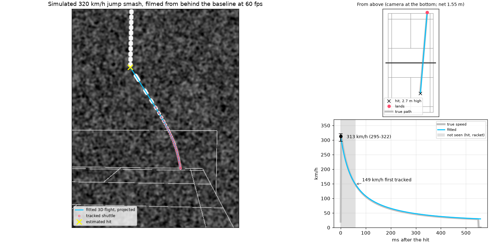

# 3D mode: match footage from any angle

The main pipeline measures speed with the camera side-on to the flight
([how it works](how-it-works.md)). Most badminton footage isn't filmed that way.
Broadcast cameras and fans in the stands film from behind a baseline, so the
shuttle flies toward or away from the camera, and a flat calibration can't turn
pixels into metres.

The 3D mode handles that. It works out where the camera is from the court
itself, then fits the shuttle's full 3D flight.



## How it works

**1. The court is the calibration target.** A badminton court has exactly known
dimensions. Mark where a handful of landmarks appear in one frame (line
crossings, and the tops and bases of the net posts). `calibrate3d` then finds the
pinhole camera that best reprojects them: its position, the direction it points,
and its focal length. It assumes square pixels, the principal point at the image
centre and no lens distortion, which suits phone video (phones correct distortion
in processing). Points off the floor, like the net post tops, pin down the focal
length much better than floor points alone. [`camera3d.py`](../shuttlecam/camera3d.py) ·
[`court.py`](../shuttlecam/court.py)

**2. One camera, but only one flight fits.** One camera can't see depth directly.
But between hits, only drag and gravity act on a shuttle:

$$\frac{d\mathbf{v}}{dt} = -k\,|\mathbf{v}|\,\mathbf{v} - g\,\hat{\mathbf{z}}$$

Push a flight further from the camera and scale it up to keep the same image, and
drag and gravity no longer bend it the same way. So only one depth reproduces the
observed track. The fit finds the hit moment, the 3D hit point and the launch
velocity that best reproduce the shuttle's pixel position in every frame
(Levenberg–Marquardt, several starting guesses).
[`fit3d.py`](../shuttlecam/fit3d.py)

**3. Timing the hit from the incoming shuttle.** The hit itself is rarely seen:
it falls between frames and the racket hides the shuttle. And the timing matters
enormously, because a smash loses a third of its speed in the first ~20 ms. The
shuttle *on its way in* solves this: the hit happens where the incoming flight
ends. `analyze3d` pairs each shot with the track that ended just before it,
extrapolates that track forward, and the fit requires the hit to sit on it.

**4. Honest error bars.** The launch speed is reported as a range covering:

- every hit moment that still fits the track;
- every distance from the camera that still fits (a single camera's weakest
  direction);
- a terminal velocity 0.2 m/s either side of the assumed 6.7 m/s, because shuttles
  differ.

The speed at the **first tracked frame** is measured rather than extrapolated, so
it is always tighter.

**5. Separating the shots.** The image tracker can follow the shuttle straight
through a hit, so tracks are split where the image speed jumps or the direction
turns. A smash flying straight away from the camera can keep the incoming
shuttle's image direction, so the speed jump is the main signal. The point next
to the hit sits near the contact, on *both* paths, so it goes to whichever side's
motion predicts it better at its timestamp. Points after the shuttle lands are
dropped. Tracks that fit poorly (limbs, shots mostly hidden behind a player) are
hidden from the report, and a launch speed is shown only when the hit was timed
and the range is tight.

## Using it

```bash
# 1. A frame and its landmarks. List the names, then type or click them.
shuttlecam calibrate3d --list
shuttlecam calibrate3d frame.png -o camera.json --overlay check.jpg \
    --points "near_base/left_doubles=123,985 near_short/centre=1012,840 far_short/right_doubles=1439,782 \
              post_left_top=711,606 post_right_top=1455,608 post_left_base=711,788 ..."
#    or: --click near_base/left_doubles near_short/centre ...   (opens a window)
#    check.jpg shows the fitted court drawn over the frame: the lines should sit on the real ones.

# 2. Find and measure the shots.
shuttlecam analyze3d match.mp4 --camera camera.json --start 515 --end 525 --plot smash.png
```

Sample output (the real rally described below):

```
shot 1: frames 216-240, 25 points
  launch speed    336 km/h   (range 325-343)
  first tracked   116 km/h   (range 109-119), frame 216, 94 ms after the hit
  hit            frame 210.4, 2.82 m high at X=+1.26 Y=-2.66
  lands          X=+2.63 Y=+7.98 at frame 240
  fit            1.26 px RMS; depth well determined
(5 other tracks hidden: poor fits, usually players or half-hidden shots. --all shows them.)
```

Hints, when you have them:

| Option | What it gives the fit |
|---|---|
| `--takeoff U,V` | pixel of the smasher's feet at take-off; pins down the distance from the camera |
| `--landing U,V@FRAME` | where and when the shuttle reached the floor; with `--takeoff`, anchors both ends of the flight |
| `--contact U,V@FRAME` | where and when the racket met the shuttle |
| `--no-incoming` | don't time the hit from an automatically paired incoming track (check the `incoming` line in the report) |
| `--hit-window N` | how many frames before the first sighting the hit may be (default 3) |
| `--track shot.csv --incoming in.csv --fps 60` | skip detection: your own `frame,u,v[,sigma]` tracks, for footage the detector struggles with |

Frame numbers in hints are the video file's own frame numbers, even when repeated
frames are dropped (below).

Use at least 6 landmarks spread across the frame, including a net post top or two.
Calibrate per camera position: if the camera is moved or re-zoomed between
rallies, calibrate again on a frame from the new position.

### Tuning the drag to a known speed

Shuttles differ (feathers or nylon, wear, the air in the hall), and the assumed
terminal velocity (6.7 m/s) sets how much speed the fit thinks was lost before the
first sighting. If you know one shot's speed from elsewhere, like a radar gun or a
broadcast reading, tune the drag to it and save the result:

```bash
shuttlecam analyze3d smash.mp4 --camera camera.json ... --known-speed 476 --save-drag drag.toml
shuttlecam -c drag.toml analyze3d next_rally.mp4 --camera camera.json   # uses the tuned drag
```

A search over the terminal velocity finds the value at which the shot's fitted
launch speed matches (lower drag, lower launch speed for the same track), then
saves it as `[tracker] terminal_velocity` in the TOML file, keeping anything else
already in it. The report shows what else moved, like the height of the hit. Check
that it still looks right, since a known speed with an error in it is absorbed
into the drag. Feather shuttles are usually 6.5–6.9 m/s, and the report flags a
value far outside that.

## How well it works

**Synthetic smashes** ([`sim.Smash3DScene`](../shuttlecam/sim.py)): rendered
behind-the-baseline clips at 60 fps, with a shuttle that has slightly more drag
than the fit assumes, run through the full automatic pipeline:

| True launch | Reported launch (range) | First tracked (true) |
|---|---|---|
| 320 km/h | 315 (294–323) | 213 (216) |
| 200 km/h | 200 (187–205) | 182 (184) |
| 380 km/h | 363 (342–384) | 135 (136) |
| 260 km/h | 256 (237–260) | 183 (187) |
| 150 km/h | 154 (144–157) | 144 (141) |

Every launch range covers the true speed, the hit moment comes out within 2–4 ms,
and first-tracked speeds land within 3%. The tests in
[`tests/test_3d.py`](../tests/test_3d.py) check this, and also check that the
calibration recovers a known camera (focal length within 1%, position within
10 cm).

**A real rally.** Tested on a jump smash by Kento Momota against Shi Yuqi, from a
60 fps fan recording filmed from the front row behind one baseline
([video](https://www.youtube.com/watch?v=7d3CMWflzzQ), 8:39). The footage is not
included in this repository.

- **Calibration:** 19 landmarks fit to 1.8 px RMS. The camera was 5.9 m behind
  the near baseline, 1.8 m up.
- **Fully automatic:** 336 km/h (325–343), hit 2.8 m above the court.
- **Checked by hand**, with the shuttle located in every frame including the two
  blurred frames right after the hit: 345 km/h (318–357), or 328 km/h (316–340)
  with the take-off hint.
- **Agreement:** all three runs put the hit at the same moment (within 0.2 of a
  frame), and the shuttle coming down on the singles sideline (on the right as
  the camera sees it), out of Shi Yuqi's reach.
- **Where it landed is less certain:** the runs place the landing anywhere from
  on the far baseline to 1.3 m behind it. That is the remaining uncertainty in
  distance from the camera, and it's largest at the far end of the flight.

So the smash left the racket at roughly 320–345 km/h. That has not been checked
against a radar gun.

## Re-uploads and broadcast footage

**Repeated frames.** Many videos online are 25 or 30 fps footage re-uploaded at
60 fps, with each real frame shown two or three times. Tracked as-is, the shuttle
would seem to stop and jump, with timestamps off by up to a frame. `analyze3d`
checks every video first: a repeat changes by almost nothing compared with a
typical new frame, so when a quarter or more of the frames are repeats (with a
clean gap between the two groups), only the real frames are kept and they are
re-timed at the real rate. It prints a line when it does this; `--keep-repeats`
turns it off.

**Far-away cameras.** One camera judges depth from perspective, from how the
shuttle's distance changes over the flight. A broadcast camera 30 m back with a
long lens sees almost none: the distance changes by only ~1.1–1.5x. The report
warns about this. The fix is to anchor both ends of the flight on the floor,
which the camera *can* locate exactly: `--takeoff` (the smasher's feet) and
`--landing` (where it came down, and when). The time between them then fixes the
speed. On a synthetic broadcast-style setup (camera 30 m back, 11 m up, 25 fps,
shuttle first seen three frames after the hit) the track alone reads 108 km/h
for a true 300, while the anchored fit gives 300 (231–346), and 414 (362–460)
for a true 420. Expect ranges of about ±20% from such footage.

**A reality check against a broadcast speed reading.** A compilation video of
fast smashes ([video](https://www.youtube.com/watch?v=tnG93YCk-fg), 0:10, not
included here) shows a jump smash from the far baseline with an on-screen
"476 KPH". The source: 25 fps broadcast footage repeated into 60 fps, from a
camera 26 m behind the court and 11.3 m up (court calibration: 34 landmarks,
1.4 px RMS).

| Run | Result |
|---|---|
| Automatic | no reliable shot (correct: little perspective, hit not seen) |
| Anchored: take-off spot + landing, `--no-incoming` | launch **469–668 km/h** (best fit 622), flagged *not reliable*; hit at frame 336, 2.8 m high above the take-off spot; lands just past the near long service line |
| Anchored, drag tuned with `--known-speed 476` | terminal velocity **7.24 m/s**; launch **477 km/h (370–534)**; hit at frame 339, 1.5 m high |

```bash
shuttlecam analyze3d broadcast_smash.mp4 --camera broadcast_camera.json --end 6.27 \
    --takeoff 1078,378 --landing 1316,953@371 --no-incoming --known-speed 476 --save-drag drag.toml
```

Untuned, the video's 476 km/h sits inside the range, at its low end, so the two
agree within what this footage can resolve. The best fit of 622 is above any
recorded smash, a sign the inputs (the exact take-off spot, the timing of a
re-encoded broadcast) carry more error than the range shows.

Tuned to 476, the fit needs a terminal velocity of 7.24 m/s, above the usual
6.5–6.9 for feather shuttles, and the hit moves down to 1.5 m, low for a jump
smash. With the same tuned drag, the Momota smash above reads 316 km/h (305–323)
instead of 336. So the tuned value is a fit to this one reading rather than a
measurement of the shuttle, and the default stays at 6.7 m/s. The tuned settings
are kept in their own file (`drag.toml`) for use with `-c`.

This clip is also fragile in another way: the shot is only ~12 frames long and
needs the motion detector settled before it starts. Analyse the whole clip.
Starting 1–3 s before the hit loses its first frames or the whole track, and moves
the launch speed by over 100 km/h.

## Limits

- **One plane at a time:** the camera must not move during the shots you analyse.
- **The hit must be timed:** without the incoming shuttle (or `--contact`), the
  launch speed is reported as unknown and only the first-tracked speed is given.
- **Shots close to the players:** a shuttle that only leaves a player's motion a
  few frames after the hit is tracked late. The launch speed still comes out (the
  incoming track times the hit), but with less to go on.
- **Shot length:** very short tracks (under ~10 points) are too short to fit and
  are hidden.
- **Terminal velocity:** the assumed 6.7 m/s suits feather shuttles. Nylon ones
  are a little faster; set `tracker.terminal_velocity`.
