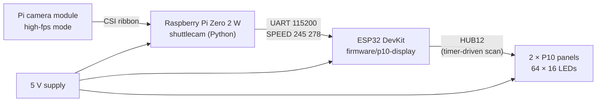

# Hardware



## Parts (v2, current)

| Part | Notes |
|---|---|
| Raspberry Pi Zero 2 W | Four cores at 1 GHz, 512 MB. Runs Raspberry Pi OS Lite (64-bit, Bookworm). |
| Pi camera module with a high-fps mode | The defaults target an **IMX219** module (Pi Camera v2 or a compatible board), whose 640×480 mode runs at about 200 fps. The Pi Zero needs the narrow 22-pin camera cable. |
| microSD card | 16 GB or more. |
| ESP32 DevKit | Any ESP32-WROOM-32 board. Drives the panels. |
| P10 LED panels, HUB12, single colour | 32×16 each. Two side by side show the speed, "KM/H" and the session best; one shows just the speed. Comes with a 16-pin ribbon cable. |
| 5 V power supply | Size it from your panels' datasheet: outdoor P10 panels can draw several amps each with many LEDs lit. The Pi and ESP32 need about 1 A together. |
| Wires, a box, a tripod or wall mount | The camera must not move once it's calibrated. |

### About the camera

- **Frame rate first.** See [how it works](how-it-works.md#1-a-shuttle-is-not-a-ball):
  the camera has to see the shuttle within a few milliseconds of the hit.
  120 fps is the practical minimum and 200 fps is better.
- **A short shutter.** The default is 1 ms. It needs a bright hall; raise
  `analogue_gain` before you raise `exposure_us`.
- **Field of view.** The IMX219's 200 fps mode reads only the centre of the
  sensor, so the view is narrower than the module's full field of view. From
  about 7 m it covers roughly 3 m of the flight, which at 200 fps is still more
  than 10 points for a fast smash. A wider view (for example Camera Module 3's
  120 fps mode) means fewer pixels per metre but sees more of the flight.
- **No fisheye lenses.** The calibration is a flat homography and does not model
  lens distortion.

## Wiring

All logic is 3.3 V. Connect every ground together.

### Pi → ESP32 (display node)

| Raspberry Pi Zero 2 W | ESP32 DevKit |
|---|---|
| Pin 8, GPIO14 (TXD) | GPIO16 (RX2) |
| Pin 6, GND | GND |
| (optional) Pin 10, GPIO15 (RXD) | GPIO17 (TX2) |

Only Pi → ESP32 is used today. The return line is wired in the firmware for later
use.

### ESP32 → P10 (HUB12)

These are the DMD32 library's default pins (VSPI). Match the signal names printed
next to your panel's input connector. The names in brackets are other labels used
for the same signal.

| ESP32 | HUB12 signal |
|---|---|
| GPIO22 | OE (nOE) |
| GPIO19 | A |
| GPIO21 | B |
| GPIO18 | CLK (SCK, S) |
| GPIO2 | LAT (SCLK, STB, L) |
| GPIO23 | R (R1, DR, data) |
| GND | GND |

Chain the second panel from the first panel's output connector with the ribbon
cable. Most HUB12 panels accept 3.3 V logic directly. If yours flicker or show
garbage, put a 74HCT245 buffer between the ESP32 and the panel.

### Power

Feed 5 V to the panels' screw terminals with thick wire. Power the Pi through its
PWR micro-USB port and the ESP32 through 5V/VIN, from the same supply or another
one with a shared ground.

## Parts (v1, retired)

| Part | Notes |
|---|---|
| ESP32-CAM (AI-Thinker) with OV2640 | Ran detection and tracking on the board. Topped out around 30 fps at 320×240. |
| USB-serial adapter | For flashing: the ESP32-CAM has no USB port. |
| The same ESP32 display node and P10 panels | v1 sent the same `SPEED` lines from its TX pin. |

See [firmware/esp32-cam-v1](../firmware/esp32-cam-v1/README.md) for why it was replaced.

## Mounting

```
           net
   ─────────┼─────────   ← court centre line: the calibrated flight plane
            │
            │  6–8 m
            │
        [camera]  ~2 m high, square to the court, looking across it
```

- Put the camera at the side of the court, level with the net or slightly toward
  the smasher's half, aimed square across the court.
- Mount it about as high as a typical smash contact point (~2 m), so the flight
  is roughly side-on.
- Further back is better. The error from a shuttle that flies off the
  centre-line plane shrinks with distance.
- Keep the P10 board out of the camera's view, or mask it (`detector.ignore_rects`).
