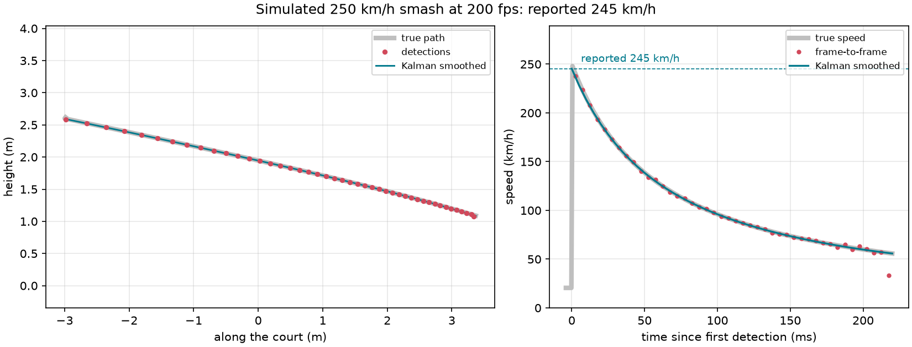
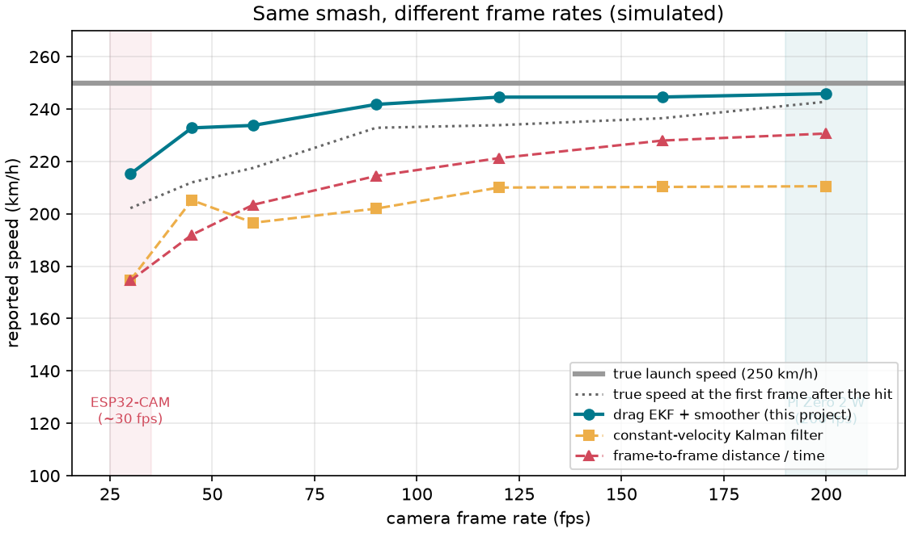

# How it works

The question is simple: *how fast was that smash?* The answer is "the shuttle's
speed the moment it left the racket". This page explains why that is harder to
measure than it sounds, and what the code does about it.

- [1. A shuttle is not a ball](#1-a-shuttle-is-not-a-ball)
- [2. Finding the shuttle](#2-finding-the-shuttle)
- [3. From pixels to metres](#3-from-pixels-to-metres)
- [4. Tracking with a drag-aware Kalman filter](#4-tracking-with-a-drag-aware-kalman-filter)
- [5. Smoothing, and the frame before the hit](#5-smoothing-and-the-frame-before-the-hit)
- [6. How well it works (simulated)](#6-how-well-it-works-simulated)
- [7. Limits](#7-limits)
- [8. Match footage, tested on a real rally](#8-match-footage-tested-on-a-real-rally)

## 1. A shuttle is not a ball

The feathers that make a shuttle fly nose-first also give it enormous drag for its
mass. Its terminal velocity, the speed at which drag equals its weight, is only
about 6.7 m/s (24 km/h). Drag grows with the square of speed, so the shuttle's
equation of motion is

$$
\frac{d\mathbf{v}}{dt} = -k\,|\mathbf{v}|\,\mathbf{v} - g\,\hat{\mathbf{y}},
\qquad k = \frac{g}{v_t^2} \approx 0.22\ \mathrm{m^{-1}}
$$

At 250 km/h (69 m/s) that drag term is $k v^2 \approx 1050\ \mathrm{m/s^2}$, more
than 100 g. With gravity ignored it has a closed form, which shows how quickly the
speed falls:

$$
v(t) = \frac{v_0}{1 + k v_0 t}, \qquad x(t) = \frac{\ln(1 + k v_0 t)}{k}
$$

For a 250 km/h smash, after one frame:

| Camera | Time to next frame | Speed by then | Distance covered |
|---|---|---|---|
| ESP32-CAM, 30 fps | 33 ms | 166 km/h (−34%) | 1.87 m |
| 60 fps | 17 ms | 200 km/h (−20%) | 1.03 m |
| 120 fps | 8.3 ms | 222 km/h (−11%) | 0.54 m |
| Pi camera, 200 fps | 5 ms | 232 km/h (−7%) | 0.33 m |

Two things follow:

1. **Frame rate matters more than anything else.** At 30 fps the camera's first
   look can come a third of the way into that drop, and a fast smash crosses the
   whole view in four or five frames. That is why v1 (ESP32-CAM) was retired.
2. **"Distance between frames ÷ time" is always too low.** It gives the
   *average* speed over the interval, and the shuttle is slowing the whole time.
   A tracker that assumes constant velocity has the same problem.

## 2. Finding the shuttle

[`shuttlecam/detector.py`](../shuttlecam/detector.py)

The camera does not move, so the detector looks for change. A pixel counts as
"shuttle" only if it differs from **both**:

- a slow running average of the scene (the background), and
- the previous frame.

The first test removes the *ghost*: the spot where the shuttle was a moment ago
looks like background again. The second test removes everything slow or static:
players walking, a bag on a bench, lighting drifting over the evening.

(The classic cheap alternative, three-frame differencing, compares the frame
with the previous two. It fires on the spot where a slow shuttle sat in *both* of
those frames, which put a fake point at the start of tracks. Tests
`test_no_ghost_where_a_slow_shuttle_used_to_be` and the pipeline tests cover it.)

Other details:

- **Flicker.** With a 1 ms shutter under mains lighting (50 Hz → 100 Hz flicker),
  whole frames brighten and darken. The detector shifts the reference by the
  change in mean brightness before comparing.
- **Blob size.** Motion pixels are grouped into connected blobs. Size limits use
  the pixels that really changed, so a single noisy pixel can't pass as a shuttle,
  and anything player-sized is dropped. In player-aware mode, small blobs right
  next to a player are flagged too (see [section 8](#8-match-footage-tested-on-a-real-rally)).
- **Sub-pixel centroids.** Each blob's centre is weighted by how much each pixel
  changed. That's sharper than the plain blob centre.
- **Speed on the Pi.** Everything stays in 8-bit OpenCV calls, which use SIMD on
  ARM, and the camera's ISP shrinks frames to 320 px wide in hardware (Picamera2's
  `lores` stream). On a desktop PC the whole pipeline takes about 1 ms per frame;
  run `shuttlecam run --stats` to see what your Pi manages.

## 3. From pixels to metres

[`shuttlecam/calibration.py`](../shuttlecam/calibration.py) · [calibration guide](calibration.md)

One camera can't see depth, so the code assumes the shuttle flies in a known
vertical plane: the court's centre line, seen side-on. A **homography** (a 3×3
projective transform) maps that plane from pixels to metres. It is fitted from
four or more points on the plane, for example the two ends of a 2 m pole held
upright at the net and again at the short service line.

The homography also tells the filter how big a pixel is at each spot in the
image. Detector noise of 1.5 px becomes a 2×2 covariance in metres,

$$ R = \sigma_{px}^2\, J J^\top, \qquad J = \frac{\partial(\text{world})}{\partial(\text{pixel})}, $$

so a far corner of the image, where a pixel covers more ground, is trusted less.

## 4. Tracking with a drag-aware Kalman filter

[`shuttlecam/kalman.py`](../shuttlecam/kalman.py) · [`shuttlecam/tracker.py`](../shuttlecam/tracker.py)

**State:** $[x, y, v_x, v_y]$ in metres and m/s, in the flight plane.

**Motion model:** the drag equation above. It's nonlinear, so this is an
**extended Kalman filter**: the state is propagated with RK4 in steps of at most
2.5 ms, and the covariance with the Jacobian of the dynamics,

$$
A = \frac{\partial f}{\partial \mathbf{s}}, \quad
\frac{\partial a_x}{\partial v_x} = -k\left(|\mathbf{v}| + \frac{v_x^2}{|\mathbf{v}|}\right), \quad
\frac{\partial a_x}{\partial v_y} = -k\,\frac{v_x v_y}{|\mathbf{v}|}, \;\dots
$$

**Process noise** is white acceleration noise whose size grows with the drag
force: a floor of 30 m/s², plus 25% of $k|\mathbf{v}|^2$. That covers spin,
tumbling, and a terminal velocity that's a little off for your shuttles.

**Starting tracks.** Detections that no track claims are paired with leftovers
from the previous two frames. A pair whose implied speed is between 50 and
450 km/h starts a candidate track. Players and a shuttle drifting down are too
slow to ever start one. When several pairs are plausible (shuttle, arm, racket),
all of them start candidates, previous-frame pairs and similar blob sizes first.
A wrong candidate predicts the next position badly, misses, and is gone within
two frames.

**Following tracks.** Each frame, every track predicts forward to the frame's
timestamp. Detections are matched greedily by Mahalanobis distance inside a
4-sigma gate. Timestamps come from the sensor, so a dropped frame just becomes a
longer prediction step, not a slower shuttle.

**Ending tracks.** A confirmed track (5+ points) ends after 3 missed frames. If it
covered at least 0.6 m and its speed is plausible, it becomes a shot.

## 5. Smoothing, and the frame before the hit

When a shot ends, the code refits it with a **Rauch–Tung–Striebel smoother**: a
forward EKF pass, then a backward pass that lets every estimate use the
measurements after it too. This matters most at the start of the track, which is
where the speed we want is and where the forward filter has seen the least data.
In the unit tests the smoother more than halves the error at the second point
compared with the forward filter alone.

Then there is the hit itself. It almost never falls exactly on a frame, so a
track often *starts on the frame before the hit*, with the shuttle still on the
racket. That point has the right **position** (the hit point) but the wrong
**time**. Smoothed as if the shuttle were already flying, it pulls the speed down
by about 5%.

So the first point is used as a position anchor only:

1. Smooth the track *without* its first point.
2. Run the smoothed trajectory backwards, between the first two frames, and find
   when it passes closest to the first point.
3. Nowhere near it → the first point was something else; drop it.
   At the first frame's own time → an ordinary in-flight point; smooth it with
   the rest. Later than that → that's when the shuttle left the racket; report
   the speed at that moment.

The reported speed is the peak of the smoothed track, which with drag is always at
the start.

## 6. How well it works (simulated)

[`shuttlecam/sim.py`](../shuttlecam/sim.py) renders synthetic clips with a known
answer: a textured hall, a swaying player, sensor noise, 100 Hz flicker, a shuttle
that drops in slowly and then gets smashed, and motion blur over the exposure. The
simulated shuttle uses a terminal velocity of 6.5 m/s, deliberately different
from the filter's 6.7 m/s, so the filter's physics are not exactly right.

Over 60 random scenes at 120 and 200 fps (90–380 km/h, launch angles from −25°
to +15°, varied hit positions, noise and flicker):

| | Mean error | Spread (1σ) | Worst |
|---|---|---|---|
| Filter drag ≠ shuttle drag (6.7 vs 6.5 m/s) | −1.5% | 0.3% | −2.1% |
| Filter drag = shuttle drag | −0.1% | 0.3% | −1.2% |

There were no false shots in 15 scenes with no smash, only a player and a
slowly falling shuttle. The bias in the first row is the drag mismatch, so set
`terminal_velocity` to match your shuttles.

The same smash at different frame rates:

The drag model with smoothing stays within 2% of the launch speed from about
120 fps up. A constant-velocity Kalman filter reads 15% low even at 200 fps,
because it treats the deceleration as noise.

These are simulation results. The algorithm is checked against a known answer,
but real halls, cameras and shuttles will add effects the simulator doesn't
model. Comparing against a radar gun is on the [roadmap](../README.md#roadmap).

## 7. Limits

- **One camera, one plane.** A shuttle flying 1 m off the calibrated plane, with
  the camera 8 m away, reads about 1/8 = 12% wrong. Mount the camera far back and
  side-on, and calibrate on the line most smashes follow.
- **Light.** A 1 ms shutter needs a bright hall. Raise `analogue_gain` before you
  lengthen the exposure: noise hurts less than blur.
- **The display.** A P10 panel in view flickers at its scan rate and changes when
  a speed appears. Keep it out of the frame, or mask it with
  `detector.ignore_rects`.

## 8. Match footage, tested on a real rally

The simulator is clean. Real match footage is not: two players lunge and swing
next to the shuttle, and a packed crowd moves behind it. To see what happens, the
tracker was run on one 22-second rally from a public 60 fps fan recording
([Shi Yuqi vs Kento Momota](https://www.youtube.com/watch?v=7d3CMWflzzQ), 1:00–1:22,
1080p). The footage is not included in this repository. It was filmed from the
front row behind one baseline, so the shuttle flies mostly toward or away from the
camera.

**Detection works.** The shuttle shows up even in front of the crowd. The trouble
is clutter: a lunging player breaks up into dozens of small moving blobs (hands,
feet, the racket) every frame, and each looks like a shuttle on its own. Out of
the box, the tracker found 1 shuttle flight and 8 junk tracks that wandered around
the players.

Two additions fixed most of that:

- **Player-aware detection** (`detector.player_margin`). Motion blobs bigger than
  `player_area` pixels count as people. Small blobs within the margin around them
  are flagged, and the tracker lets a flagged blob *continue* a track but never
  *start* one. A pair whose older point is next to a player can still start a
  track, because that is usually the shuttle leaving the racket.
- **Jitter check** (`tracker.max_jitter`). After smoothing, the RMS distance of the
  detections from the smoothed path, in units of the expected detector noise. A
  shuttle flies a clean curve; limbs jump about.

  | | Jitter |
  |---|---|
  | Simulated shuttle tracks (30 random smashes) | 0.04 – 0.16 |
  | Real shuttle flights in the rally | 0.07 – 0.42 |
  | Junk tracks around the players and in the crowd | 0.76 – 1.28 |

  The default limit of 1.0 only catches wild junk. Use 0.6 for crowded footage.

With both on (`player_margin = 12`, `max_jitter = 0.6` at 960 px wide), the rally
gave 4 clean shuttle flights and no junk tracks. Neither setting changes any of
the simulated results above.

**What still doesn't work on this footage:**

- **Speed from this angle** needs the 3D mode: the shuttle moves mostly in depth,
  so the single-plane calibration in section 3 can't apply. See
  [3D mode](3d-mode.md), which calibrates the camera from the court and fits each
  shot's 3D flight. It measured a smash from a later rally of the same video.
- **Shots close to the players.** All the flights found in this rally were lifts
  and clears above the players. Fast flat shots pass through the players' motion,
  and a smash is often only picked up a few frames after it leaves the racket (the
  3D mode copes by timing the hit from the incoming shuttle).
- **Short visible flights.** A high clear that leaves the top of the frame within
  a few frames never reaches `min_hits` points.
- **Camera drift.** A handheld or re-framed camera moves between rallies, so the
  background and any calibration need resetting when it does.
