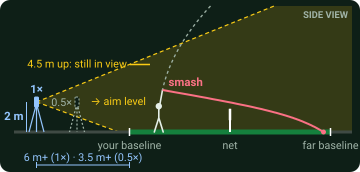
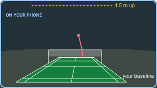

# Web app: measure smashes at the court with a phone

`shuttlecam serve` runs a small website on a PC. At the court, a phone films a smash,
uploads the clip, and gets the speed back. The PC does the processing
([3D mode](3d-mode.md)); the phone only needs a browser and, for the private set-up
below, the Tailscale app.

```
phone (Tailscale app) ──https, private──> PC: shuttlecam serve ──> shuttlecam analyze3d
```

## On the PC

```bash
pip install -e ".[web]"               # Flask, Waitress, Matplotlib
shuttlecam serve                      # or: shuttlecam -c drag.toml serve
```

It prints the address and a passcode (random the first time, then kept; set your
own with `--passcode`). Clips, results and camera spots go in `~/shuttlecam-web`
(`--data` to change it). While it runs, the PC won't go to sleep. Processing
takes about a minute per clip on a desktop PC, one clip at a time.

With `-c drag.toml`, every clip uses a shuttle drag you tuned with
`analyze3d --known-speed` ([3D mode](3d-mode.md#tuning-the-drag-to-a-known-speed)).
The page footer shows which terminal velocity is in use.

### Reaching it from the court

By default the server only listens on the PC itself. Pick one way in:

| | Phones need | Who can reach it |
|---|---|---|
| **Tailscale, private** (recommended) | the Tailscale app, signed in | only devices on your Tailscale network |
| Tailscale Funnel | nothing | anyone with the link (the passcode still applies) |
| Same Wi-Fi | to be on the PC's network | anyone on that network |

Tailscale, once:

```bash
tailscale login                       # sign in to your (free) Tailscale account
tailscale serve --bg 8000             # https://<pc>.<tailnet>.ts.net, on your tailnet only
tailscale serve status
```

Install the Tailscale app on your phone and sign in to the same account; the link
then opens anywhere, on Wi-Fi or mobile data. To let friends in, share the PC with
them from the Tailscale admin console (they install the app and accept), or invite
them to your tailnet. The setting survives restarts; `tailscale serve --https=443
off` removes it.

For a public link instead, `tailscale funnel --bg 8000` (it asks you to approve
Funnel once) and `tailscale funnel --https=443 off` to close it again. On the same
Wi-Fi, run `shuttlecam serve --host 0.0.0.0` and open `http://<pc-ip>:8000`.

## Where to put the phone

The page shows this to scale, in "Where to put the phone":



- **Behind the smasher**, near the middle (up to a metre to one side). Their smashes
  then fly away from the camera.
- **6 m or more behind the baseline** with the normal 1× camera (about 70° by 42°
  in 16:9 video), or **3.5 m or more** with the 0.5× ultra-wide (about 100° by 65°).
  That's the closest the phone can be and still see both your baseline and a
  shuttle 4.5 m above your back court (coming down onto a smash), with both
  sidelines in view.
- **About 2 m high, aimed level.** At 1.5 m tilt up about 5°, at 2.5 m down about 3°.
- **Not far away or high up.** Depth comes from perspective: how much the shuttle's
  distance from the camera changes over the flight. From 4–8 m back it changes by
  2–3×; from 12 m, under 2×; the 26 m broadcast camera in [3D mode](3d-mode.md) saw 1.35×.

Checked on rendered smashes (true speed 320 km/h, full pipeline):

| Set-up | Smash away from the camera | Smash toward the camera |
|---|---|---|
| 1×, 6.2 m back, 2 m up | 318 (303–325) | rough only (302–458) |
| 0.5×, 3.5 m back, 2 m up | 312 (289–326) | 344 (298–443) |
| 25 m back, 8 m up, zoomed | 382 (333–444): wrong | nothing reliable |

Smashes toward the camera start far from it, where it judges distance worst: hence
"behind the smasher".



### Wide and fisheye lenses

The court calibration models a straight-line (pinhole) camera. Phones correct their
lenses in processing, including the 0.5× ultra-wide (iPhone: Settings › Camera ›
Lens Correction, on by default), so those work. A lens that bends straight lines
doesn't. The same smash and court, seen through each lens and measured as usual:

| Lens | Court fit | Speed for a true 320 km/h |
|---|---|---|
| 0.5× ultra-wide, corrected (phone default) | exact | 305 (282–320) |
| ultra-wide with the correction off | 9.7 px (worst point 33 px) | 339 (313–355) |
| 150° fisheye (clip-on lens, action-cam wide modes) | 12 px (worst point 44 px) | 366 (339–381) |

So: no clip-on fisheye, and on a GoPro use Linear mode. The court check screen
warns when the points fit looser than 6 px, which is what a bending lens does.

The pictures are drawn from the court model by `tools/make_web_guide.py`.

## At the court

1. **Film.** Phone on a stand behind the smasher, as above, landscape. 60 fps or
   faster; 1080p is plenty.
2. **Trim** each clip to start about a second before the smash, with the shuttle
   coming in, and end after it lands. Upload the original from the camera roll,
   not a copy sent through a chat app: recompression can wipe out the shuttle.
3. **Upload.** The first clip from a new camera spot asks you to **mark the court**:
   tap each point on a frame from your clip, then drag to fine-tune it under the
   magnifier. Skip any you can't see; at least 6 are needed, and a net post top
   helps most. The page then draws the fitted court over the frame: if the red
   lines sit on the real ones, accept it.
4. **Read the speed.** Every later clip from the same spot is measured straight
   away. The result shows the launch speed with its likely range, where the hit
   was and where the shuttle landed, plus the fitted flight. "Best per player"
   ranks everyone's fastest smash.

How the number is shown:

| Shown | Meaning |
|---|---|
| **336 km/h** | launch speed, measured with a tight range |
| **~477 km/h** (amber) | a rough estimate: the range is wide (far camera, few frames) |
| **≥116 km/h** (amber) | the hit wasn't timed (no incoming shuttle in the clip), so only the speed when first seen is known |

Move the phone, and pick "New camera spot" on the next upload.

## Tested

Momota's jump smash from [3D mode](3d-mode.md#how-well-it-works), cut to a 2 s clip
the way a phone would trim it, uploaded as HEVC `.mov` (iPhone format), with the
court marked by tapping on a 375 px wide phone screen:

| | Phone flow | Desktop, full clip |
|---|---|---|
| Court marking | 10 points, 2.85 px; camera 6.0 m behind the baseline, 1.8 m up | 19 points, 1.8 px; 5.9 m, 1.8 m |
| Launch speed | **337 km/h** (315–345) | 336 km/h (325–343) |
| Hit | 2.81 m high | 2.82 m high |

Short clips needed one change in the analysis: the motion detector learns the
empty court from the first frame, and a clip that starts a second before the smash
doesn't give it time to forget where the players stood. Clips under 4 s now start
it from the median of the clip's frames instead (`analyze3d --background`).

## Security

With the private Tailscale set-up only your devices can reach the site at all. If you
turn on Funnel, it's on the public internet, so either way:

- Every request needs the passcode; wrong guesses are limited to 8 per 10 minutes.
- Changes also need a request header that another website can't send, on top of
  same-site cookies.
- Uploads must be videos OpenCV can read, up to 500 MB and 30 s; they're stored
  under random names. Each clip is measured in its own process with a 15-minute
  limit.
- The server listens on 127.0.0.1 unless you say otherwise: only Tailscale (or this
  PC) can reach it. With `tailscale serve` (not Funnel), only devices on your
  Tailscale network can.

Share the passcode only with the people you play with, and change it with
`--passcode` if it gets around.
